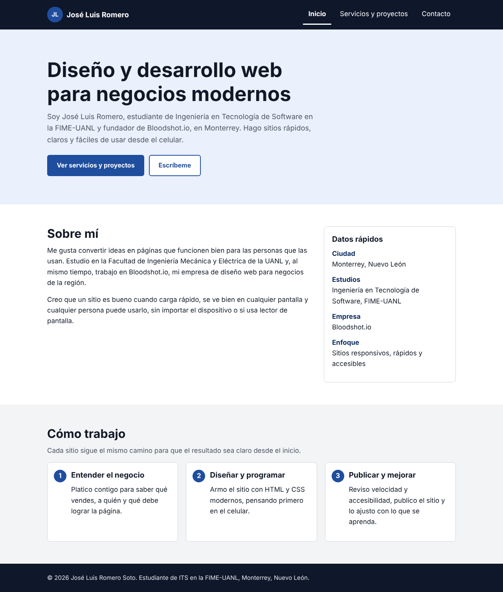
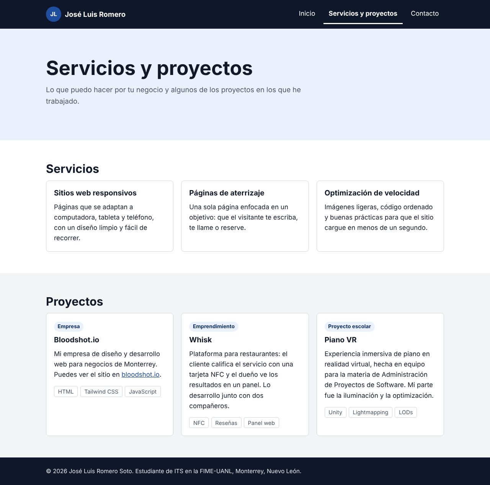
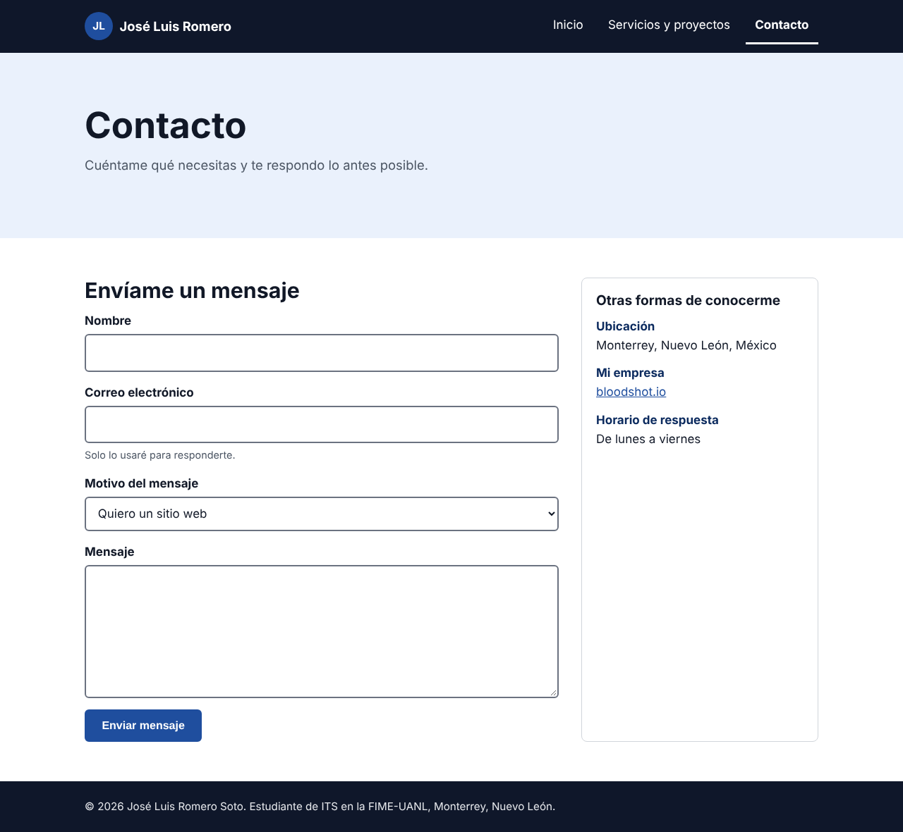
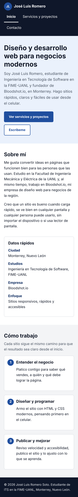
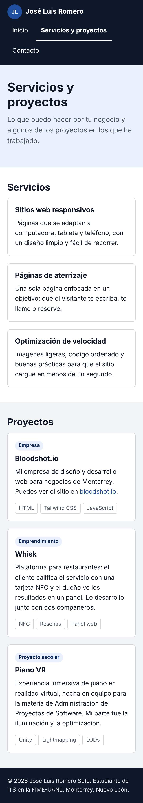
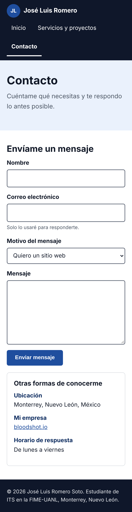

# Portafolio de José Luis Romero Soto

Sitio web responsivo, semántico y accesible hecho para la **Actividad 2** del Laboratorio de Programación Web (FIME-UANL).

- **Alumno:** José Luis Romero Soto (matrícula 2038132)
- **Sitio publicado:** `PEGAR AQUÍ EL LINK DE GITHUB PAGES`

## Objetivo

Construir y publicar un sitio web con HTML5 semántico y CSS moderno, aplicando principios básicos de usabilidad, accesibilidad y validación de estándares.

## Caso elegido

Portafolio profesional. El sitio presenta quién soy, qué servicios de diseño web ofrezco y en qué proyectos he trabajado, y permite que alguien me escriba desde un formulario.

## Vistas del sitio

| Archivo | Vista | Contenido |
|---|---|---|
| `index.html` | Inicio | Presentación, sección "Sobre mí" y cómo trabajo |
| `servicios.html` | Servicios y proyectos | Tres servicios y tres proyectos |
| `contacto.html` | Contacto | Formulario de contacto y otros datos |

## Tecnologías

- HTML5 (etiquetas semánticas)
- CSS3 con Flexbox y Grid, sin frameworks ni librerías
- Git y GitHub Pages para la publicación
- Visual Studio Code como editor

## Estructura de carpetas

```
/
├── index.html
├── servicios.html
├── contacto.html
├── css/
│   └── styles.css
├── docs/
│   └── capturas/        (capturas de escritorio y móvil)
└── README.md
```

## Decisiones de diseño

**HTML semántico.** Cada página usa `header`, `nav`, `main`, `section`, `article`, `aside` y `footer`. No hay tablas para el diseño.

**Diseño con CSS.** Flexbox se usa en el encabezado, el menú, los botones y el formulario. Grid se usa en las tarjetas y en las columnas de contenido.

**Responsividad.** El CSS está pensado primero para celular. Hay un breakpoint en `768px`: a partir de ahí el encabezado pasa a una sola fila y las tarjetas se acomodan en tres columnas.

**Accesibilidad.**

- Enlace "Saltar al contenido" al inicio de cada página.
- Un solo `h1` por página y encabezados en orden (`h1`, `h2`, `h3`).
- Todos los campos del formulario tienen su `label` y los obligatorios llevan `required`.
- Navegación con `aria-label` y `aria-current="page"` en la vista actual.
- Los íconos decorativos llevan `aria-hidden="true"`.
- Foco visible en enlaces, botones y campos.
- Contraste de color mayor a 4.5:1 en todos los textos (el más bajo es 6.7:1).
- Botones y enlaces del menú con área táctil suficiente.

## Capturas

Escritorio:





Móvil:





## Resultados de validación

| Herramienta | Archivo | Resultado |
|---|---|---|
| W3C Markup Validation Service | `index.html` | `PEGAR RESULTADO` |
| W3C Markup Validation Service | `servicios.html` | `PEGAR RESULTADO` |
| W3C Markup Validation Service | `contacto.html` | `PEGAR RESULTADO` |
| W3C CSS Validation Service (Jigsaw) | `css/styles.css` | `PEGAR RESULTADO` |

## Cómo ver el sitio en tu computadora

1. Descarga o clona el repositorio.
2. Abre `index.html` en el navegador.

## Nota sobre el formulario

El sitio es estático, así que el formulario de contacto todavía no envía el mensaje a ningún correo. Para recibir mensajes se puede conectar a un servicio como Formspree o Netlify Forms.
